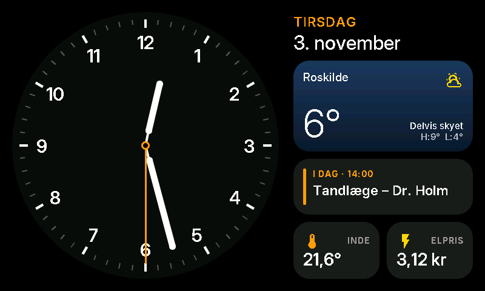
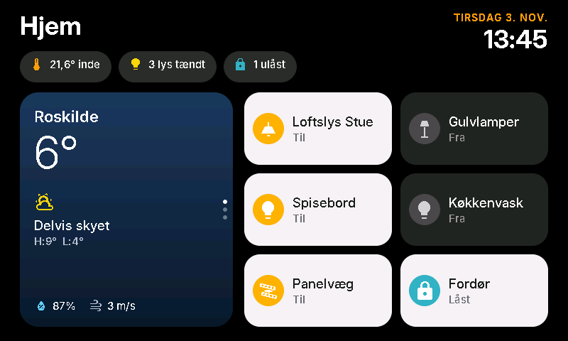
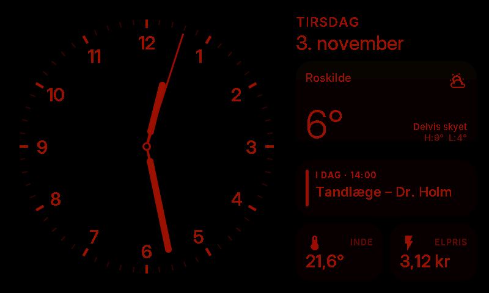
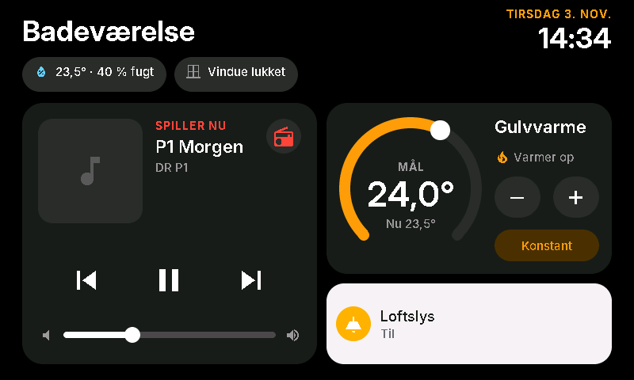
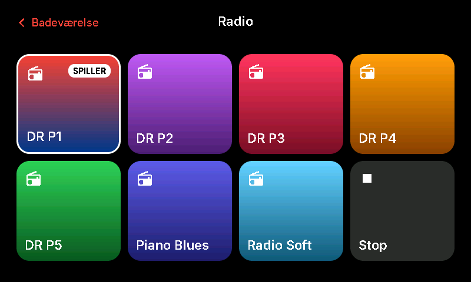
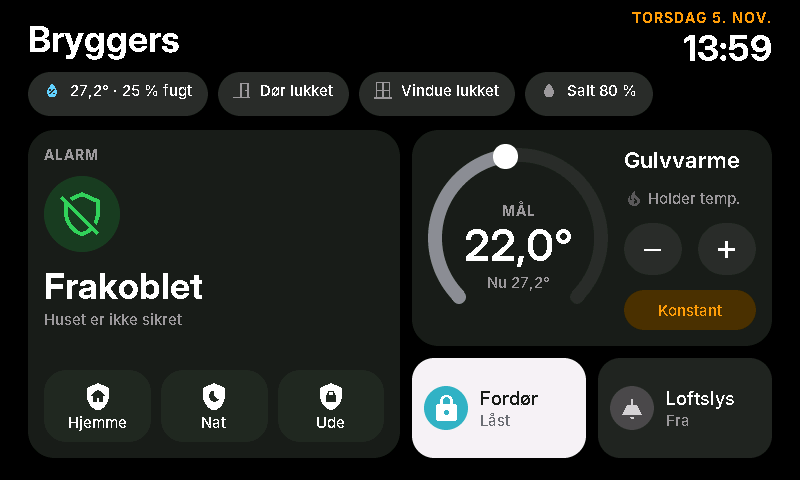
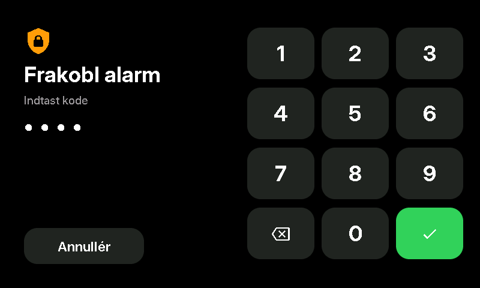
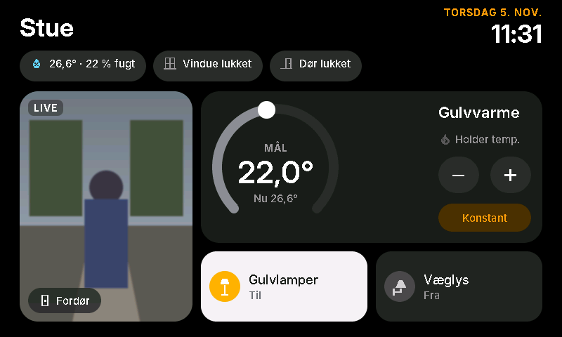
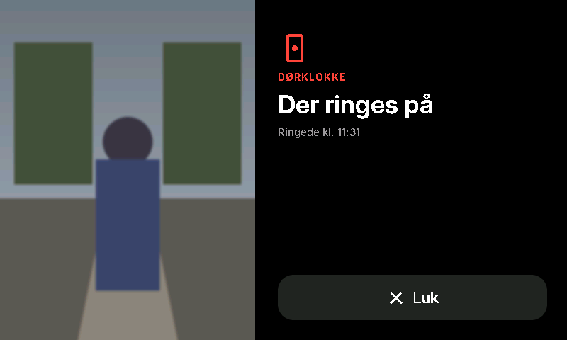

# HomeView for ESPHome

An Apple **HomeView**-inspired smart display for the **Waveshare ESP32-S3-Touch-LCD-5** and
**ESP32-S3-Touch-LCD-4.3B**, built with ESPHome + LVGL 9, with Home Assistant as the backend.

| Face (always-on) | Home (someone close) | Night |
|---|---|---|
|  |  |  |

The screenshots are real renders of this config. They come from the ESPHome `host`
platform with an SDL window (`preview-host.yaml`), so what you see is what the
panel will draw.

## Rooms

Each display can be a **room device**. It shares the core (hardware, theme, presence, proximity, Face page)
and adds its own pages from `rooms/<room>/`.

| Device file | Pages |
|---|---|
| `homeview.yaml` | generic: Face + whole-home dashboard |
| `homeview-badevaerelse.yaml` | Face (bath temp + humidity) · Home (Now Playing, floor heating, light) · Radio (Sonos favourites) |
| `homeview-bryggers.yaml` | **4.3B board.** Face (utility-room temp + humidity) · Home (alarm: status, arm Hjemme/Nat/Ude, PIN keypad to disarm; floor heating; front-door lock; light; door/window/salt chips) · full-screen water-leak and fire alerts |
| `homeview-stue.yaml` | Face (living-room temp + humidity) · Home (doorbell camera, floor heating, Gulvlamper, Væglys, window + door chips) · full-screen doorbell view when someone rings |

| Badeværelse – Home | Radio |
|---|---|
|  |  |

| Bryggers – Home | Bryggers – disarm keypad |
|---|---|
|  |  |

| Stue – Home | Stue – doorbell rings |
|---|---|
|  |  |

**Adding a room:** copy `homeview-badevaerelse.yaml` to `homeview-<room>.yaml`, and copy `rooms/badevaerelse/`
to `rooms/<room>/`. Change `device_name` and the `room_*` entities, then rearrange the widget includes.
Every page must keep the ids `home_page` (and `face_page` from the shared Face), because the presence logic
switches between those two.

## How it behaves (modelled on Apple HomeView)

| State | Trigger | Screen |
|---|---|---|
| **Ambient** | nobody within the proximity distance | **Face**: analog clock, date and four widgets (weather, next event, indoor temp, electricity price) |
| **Near** | proximity sensor sees someone closer than *Nærhedsafstand* | wakes the backlight and slides to **Home** (if *Åbn Hjem ved nærhed* is on) |
| **Idle** | no touch for *Tilbage til urskive efter* seconds and nobody near | fades back to the Face |
| **Sleep** *(optional)* | *Sluk skærm uden nærhed* on, and nobody near for *Sluk skærm efter* minutes | backlight off. Proximity or a touch wakes it |
| **Night** | *Nattilstand* switch, e.g. from an HA automation at bedtime | red StandBy-style tint over everything |

Gestures: tap or swipe left on the Face opens Home. Swipe right, or tap the time, returns to the Face.
Swipe up or down on the Smart Stack to flip cards. Tap a tile to toggle it. Lock tiles **lock on tap**
but need a **long-press to unlock**, so you can't open the door by accident.

The **Side** select entity lets HA automations change the page, for example "show Home when the doorbell rings".

## Folder layout (modular)

```
homeview.yaml                     device file: substitutions (entities, tiles) + package list
packages/
  hardware/waveshare-s3-touch-lcd-5.yaml    5" board: RGB panel, GT911, CH422G, backlight
  hardware/waveshare-s3-touch-lcd-4.3b.yaml 4.3B board (own panel timing)
  hardware/layout-800x480.yaml            geometry for the 5"  (SKU 28117)
  hardware/layout-1024x600.yaml           geometry for the 5B  (SKU 28151)
  core/base.yaml        wifi/api/ota/time
  core/theme.yaml       Apple dark design system: colours, Inter fonts, styles, overlays
  core/presence.yaml    ambient/near/idle/sleep/night state machine
  sensors/proximity-vl53l0x.yaml       ToF on the I2C header (recommended)
  sensors/proximity-ld2410.yaml        mmWave over UART (read the pin warning)
  sensors/proximity-homeassistant.yaml use any existing HA presence sensor
  pages/face.yaml, pages/home.yaml
rooms/<room>/home.yaml                 room pages (badevaerelse, stue, bryggers)
widgets/<name>/ui.yaml + data.yaml     reusable widgets
components/homeview/                   external component with the C++ helpers
                                       (Danish names, weather glyphs, number formatting)
example-device.yaml                    device file that pulls everything from this repo
homeassistant/homeview.yaml            HA package that feeds the display
fonts/                                 Inter + Inter Display (OFL), Material Design Icons
preview-host.yaml                      desktop preview with demo data
homeview-bringup.yaml                  single-file hardware test
```

### Re-using widgets in other projects
Each widget is a pair of files. `ui.yaml` is a single LVGL widget that you `!include` into any
`widgets:` list. `data.yaml` is a package holding the HA subscriptions and update logic. Both
take the same `uid` var, so you can use as many instances as you like:

```yaml
packages:
  kitchen_temp: !include
    file: widgets/value/data.yaml
    vars: { uid: kitchen_temp, entity: sensor.kitchen_temperature, decimals: "1", unit: "°" }
lvgl:
  pages:
    - widgets:
        - !include
          file: widgets/value/ui.yaml
          vars: { uid: kitchen_temp, x: 20, y: 20, width: 142, height: 94,
                  icon: "\U000F050F", icon_color: "0xFF9F0A", label: "KØKKEN" }
```
Widgets depend only on `packages/core/theme.yaml` (styles, fonts and the `homeview` helper component).

| Widget | What it is |
|---|---|
| `clock_analog` | Apple-style analog clock: stem+body hands, orange seconds hand, "Vis sekundviser" switch |
| `date_header` | orange weekday + large date |
| `weather` | Apple Weather widget look with sky gradient, condition icon, H/L |
| `calendar` | "Up next" event with a coloured bar |
| `value` | small square complication for any numeric sensor |
| `status_chip` | Home-app header pill showing an HA text sensor |
| `home_tile` | iOS 18 Home accessory tile (toggle) |
| `lock_tile` | lock tile: tap = lock, long-press = unlock |
| `smart_stack` | rotating Weather / Calendar / Electricity cards with page dots and swipe |
| `page_header` | large room title + date/time, tap the time to return to the Face |
| `media_player` | Now Playing: artwork (via HA media proxy), title/artist, ⏮ ⏯ ⏭, live volume slider, radio button |
| `station_tile` | radio station card that selects a Sonos favourite; highlights the one playing |
| `climate_dial` | thermostat arc (drag or −/+ in 0.5° steps, debounced), heating state, preset toggle |
| `alarm_panel` | alarm status card (Frakoblet/Hjemme/Nat/Tilkoblet, exit countdown, ALARM) with Nat/Ude arm buttons behind a confirmation dialog (`confirm.yaml`), plus a PIN keypad (`keypad.yaml`, top layer) that sends the typed PIN to an HA script; HA checks the PIN, counts wrong attempts and locks out |
| `alert_overlay` | full-screen warning while a binary sensor is on (water leak, fire); wakes the screen, "Luk" snoozes it |
| `doorbell_camera` | camera tile (snapshot refreshed every 2 s, LIVE/RINGER badge) + full-screen view (`overlay.yaml`, goes in `top_layer`) that opens when the doorbell rings; snapshots come scaled from HA's camera proxy, ~1 fps full screen |

## Setup

1. **Home Assistant**: copy `homeassistant/homeview.yaml` to `/config/packages/`. Make sure
   `homeassistant: packages: !include_dir_named packages` is in `configuration.yaml`, then restart.
   This creates `sensor.homeview_*` (forecast high/low, next event and agenda, chip texts, price level),
   plus `script.homeview_media_skip`, which the ⏮/⏭ buttons use: it steps through the Sonos
   favourites when a radio station is playing, because radio streams can't skip tracks.
   Room packages (`homeview_badevaerelse.yaml` and so on) go in the same folder.
2. **ESPHome**: the easy way is to keep only your device file in your ESPHome folder and pull
   everything else from this repo (see *Using it straight from GitHub* below). Or clone the whole
   repo into your ESPHome folder and use the local paths. The secrets used are `wifi_ssid`,
   `wifi_password`, `api_encryption_key` and `fallback_ap_password`.
3. Pick the hardware file for your board (`waveshare-s3-touch-lcd-5.yaml` or `waveshare-s3-touch-lcd-4.3b.yaml`),
   the layout that matches the panel (800x480 or 1024x600) and **one** proximity package.
   The 5" 800x480 and the 4.3B are both 800x480, so every room page runs on either.
4. Flash over USB the first time. Then in HA, open **Settings › Devices › ESPHome › HomeView › Configure**
   and turn on **"Allow the device to perform Home Assistant actions"**. The tiles need this.
5. Adjust *Nærhedsafstand*, *Tilbage til urskive efter* and the other entities from the HA device page.

## Using it straight from GitHub

Copy [`example-device.yaml`](example-device.yaml) to your ESPHome folder as `homeview-<room>.yaml`.
That is the only file you keep locally (plus `secrets.yaml`). It pulls everything else from this
repo at a fixed release tag:

```yaml
substitutions:
  homeview_ref: "v2.0.0"      # release tag to use; change it to update
  homeview_components: "github://briis/homeview-esphome@${homeview_ref}"
  fonts_dir: "https://raw.githubusercontent.com/briis/homeview-esphome/${homeview_ref}/fonts"
  # ... your room entities ...

packages:
  homeview:
    url: https://github.com/briis/homeview-esphome
    ref: ${homeview_ref}
    refresh: 1d
    files:
      - packages/hardware/layout-800x480.yaml
      - packages/hardware/waveshare-s3-touch-lcd-5.yaml
      - packages/core/base.yaml
      - packages/core/theme.yaml
      - packages/core/presence.yaml
      - packages/sensors/proximity-vl53l0x.yaml
      - packages/pages/face.yaml
      - rooms/stue/home.yaml
```

- **Why three settings:** packages come from the repo clone, but ESPHome resolves `font:` files
  and external components separately. `homeview_components` points at the helper component, and
  `fonts_dir` downloads the fonts from the same tag.
- **Updating:** change `homeview_ref` to a newer tag and reinstall. Pinning a tag means a push to
  `main` never changes a device by surprise.
- **Radio logos** (`rooms/badevaerelse/logos.yaml`) are not in the repo. Put the PNGs in
  `images/radio/` next to your device file.
- **Home Assistant packages** (`homeassistant/*.yaml`) still need copying into `/config/packages/`.

Tip: flash `homeview-bringup.yaml` first. It shows the measured distance on screen and logs touches,
which is handy while you place the sensor in the enclosure.

## Proximity sensor & enclosure notes

* **VL53L0X (recommended)**. It uses the I2C header (GPIO8/9, 3V3, GND), which is already shared with
  the touch controller, so you need no extra GPIO. It is optical: leave a **~5 mm hole** in the bezel,
  or glue IR-transparent acrylic in front of it. Mount it flush with the inside of the front wall and
  tilt it 5–10° downward so it sees a standing person's torso. It reads reliably up to about 1.2 m,
  and further with `long_range`.
* **LD2410C mmWave** sees *through* PLA and PETG, so the enclosure needs no hole. The catch is that this
  board has almost no free GPIOs: GPIO43/44 go to the RS485 transceiver and GPIO15/16 to the CAN
  transceiver. Only use it if you have verified a free pin pair.
* The backlight is **on/off only** on this board (CH422G EXIO2) and has no PWM. That is why Night mode
  uses a software multiply-tint instead of dimming.

## Desktop preview
`esphome run preview-host.yaml` (needs SDL2: `brew install sdl2`). Set `preview_screen` to `face`,
`home` or `night`. The `libraries:` line pins LVGL to its git repo, which is only needed where the
PlatformIO registry is blocked.

## Licence

MIT (see [LICENSE](LICENSE)). The fonts in `fonts/` keep their own licences:
Inter / Inter Display (SIL Open Font License 1.1, see `fonts/LICENSE-Inter-OFL.txt`) and
Material Design Icons (Apache License 2.0).
