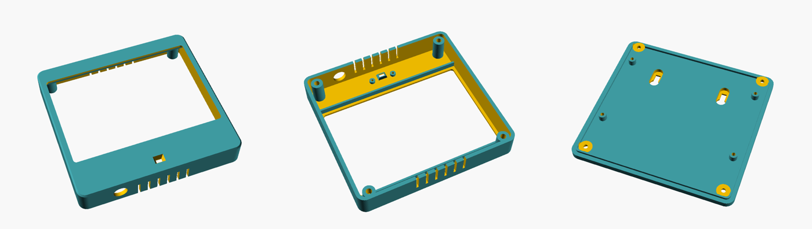
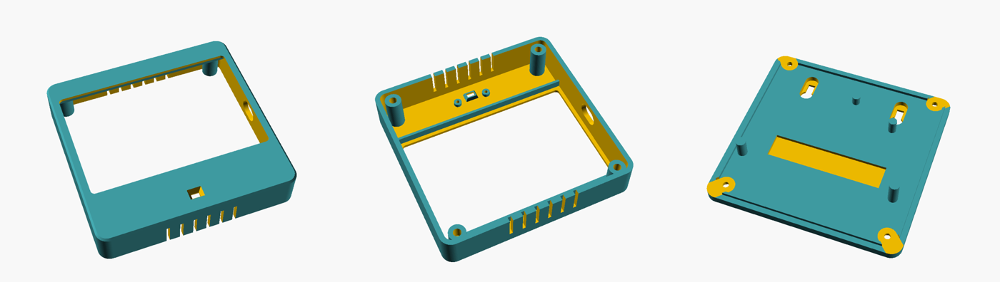
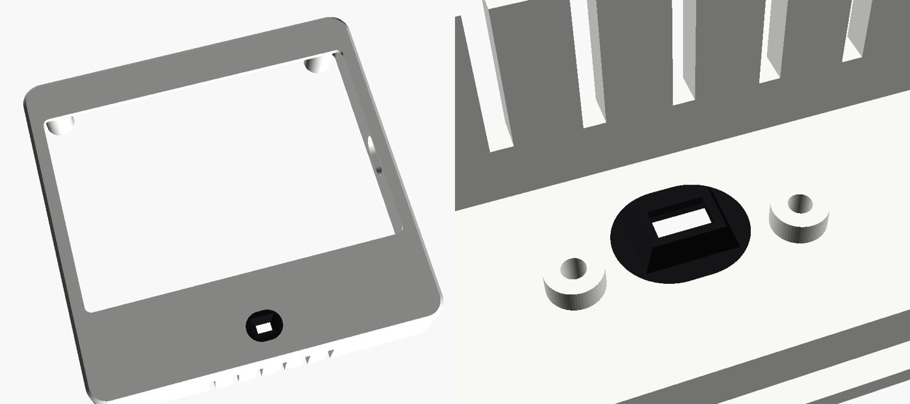
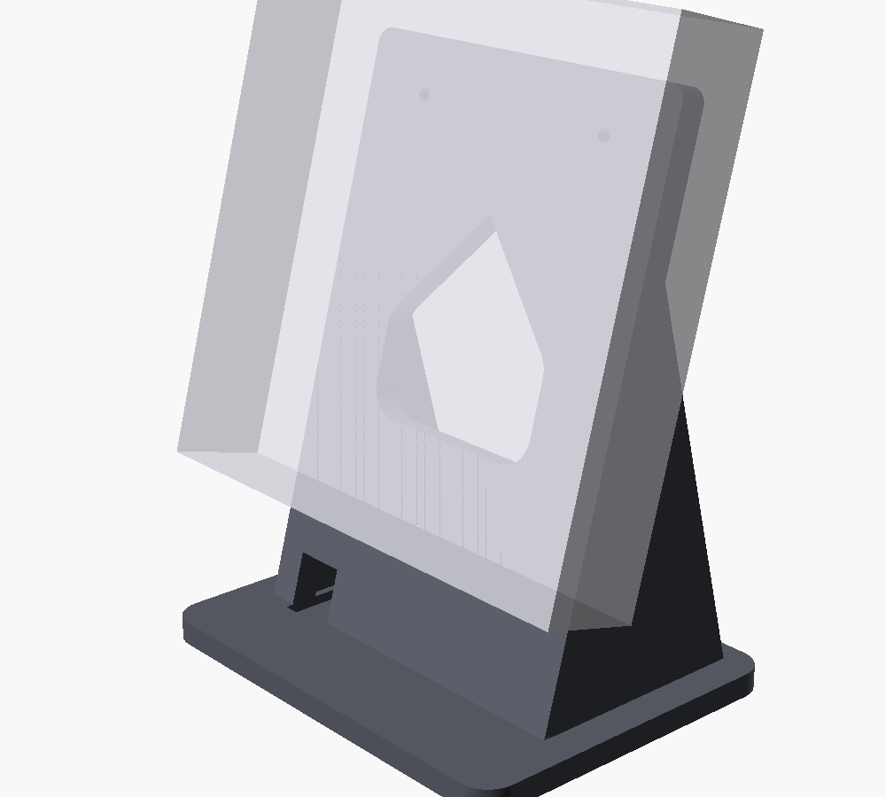
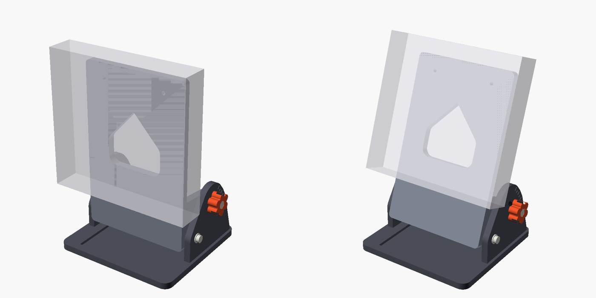
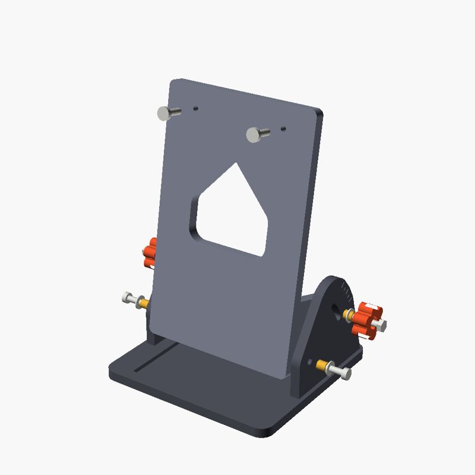

# HomeView enclosures (3D print)

3D-printable wall cases and desk stands for the HomeView displays, with a built-in mount for the
VL53L0X proximity sensor. Everything is parametric OpenSCAD; the STLs here are exported from those
sources and are ready to slice.

| Board | Case | Power |
|---|---|---|
| Waveshare **ESP32-S3-Touch-LCD-5** | `homeview_wall_case.scad` → `stl/5inch/` | 12 V round DC panel socket in the bottom wall |
| Waveshare **ESP32-S3-Touch-LCD-4.3B** (Rev 1.1) | `homeview43_wall_case.scad` → `stl/4.3B/` | The board's own USB-C port, through the right side wall |

Both cases hang on two screws 60 mm apart (a standard EU/DK wall box). The hanging screw sits at the same
height above the case bottom on both, so **both desk stands fit both cases** without changes.

## Folder contents

```
enclosure/
├── scad/                          parametric sources (OpenSCAD)
│   ├── homeview_wall_case.scad    5" case
│   ├── homeview43_wall_case.scad  4.3B case
│   ├── homeview_desk_stand.scad   fixed 15° desk stand
│   └── homeview_desk_stand_tilt.scad  adjustable 0–20° desk stand
├── stl/
│   ├── 5inch/   homeview5_front | _white | _black | _back | _testfit .stl
│   ├── 4.3B/    homeview43_front | _white | _black | _back | _testfit .stl
│   └── stands/  desk_stand_fixed15 | desk_stand_tilt_base | _upright | _knob .stl
└── images/      renders used in this README
```

## Which files to print

| File | What it is | Print |
|---|---|---|
| `…_testfit.stl` | The bezel ring only (and on the 4.3B, the side wall around the USB-C opening). Prints in ~20 min. | First, to check the screen fit (and the USB plug) |
| `…_front.stl` | Front shell in **one colour**: bezel, walls, sensor mount, screw bosses, vents | **Black**, face down, no supports |
| `…_white.stl` + `…_black.stl` | The same front shell split for a **two-colour** printer: white case, black sensor area | Together as one object (see below) |
| `…_back.stl` | Back plate: keyholes, recessed M3 screws, posts that press the screen forward | Flat, any colour |

Print either `…_front.stl` **or** the `…_white` + `…_black` pair, not both.

## 5" case — ESP32-S3-Touch-LCD-5



- Outer size **134.1 × 127.7 mm**, 25.8 mm deep (front shell 20.8 + back plate 5).
- Glass 127.7 × 87.45 mm (R4 corners). Clearance 0.20 mm per side left/right, 0.10 mm up/down.
- The back-plate posts land on the board's four M2.5 standoffs (111 × 63 mm) and clamp the screen
  against the bezel. Optional M2.5×12 screws through the posts.
- Ø11.2 mm hole for a round 12 V DC panel socket in the bottom wall, 35 mm left of centre seen from the front.

## 4.3B case — ESP32-S3-Touch-LCD-4.3B



- Outer size **118.5 × 115.2 mm**, 27.2 mm deep (front shell 22.2 + back plate 5).
- Glass 112.4 × 75.1 mm (R4 corners). Clearance 0.05 mm per side.
- **USB-C power:** a rounded 15 × 10 mm opening in the right side wall (seen from the front). It is large
  enough for the plug's moulded housing to go in, because the socket sits inside the wall. A 90° USB-C
  cable pointing down looks neatest. There is no DC socket on this case.
- The board has no standoffs, so the back plate has four posts placed on free areas: two on bare PCB / the
  ESP32 module, two on the metal back of the LCD below the PCB. Each post stops **1 mm short** of its surface:
  **stick a ~1.5 mm foam pad on each post tip.**
- A 2 mm pocket in the back plate clears the green terminal block, which stands 20.3 mm behind the glass
  (Waveshare's drawing says 17.4; the measured value is what counts).
- Depths measured with calipers (from the glass front): PCB back 10.5 · ESP32 module top 13.6 ·
  LCD back bottom-left 8.2 · LCD back bottom-right 4.9 · terminal block top 20.3 mm.

## Two-colour printing (Bambu H2D and other multi-material printers)



`…_white.stl` and `…_black.stl` are two bodies in the same coordinates that fuse into one front shell.
The black body is a 12 × 10 mm oval through the bezel around the sensor window plus the sealed pocket
around the sensor chip. That is everything the infrared beam passes through or alongside, so crosstalk
stays blocked while the rest of the case is white. On the front it shows as a small black oval.

In Bambu Studio:

1. Select **both** files (`…_white.stl` and `…_black.stl`) and drag them in together.
2. Answer **Yes** to *"Load these files as a single object with multiple parts?"*. They are already in
   the right place relative to each other.
3. Assign white filament to the white part and black to the black part.
4. Print face down as usual.

White PLA lets light through, so check whether the screen's backlight glows through the 1.8 mm white bezel.

## Desk stands

Both stands hold the **unchanged** case by its two back-plate keyholes, exactly as on the wall, and it
lifts off again.

### Fixed 15° stand — `desk_stand_fixed15.stl`



- 15° tilt, case bottom 32 mm above the table (room for a DC plug). Footprint 118 × 92 mm, height 148 mm.
- Cable arch through the upright and a channel in the base, under the 5" case's DC socket.
- Print base down, no supports. Hardware: 2 × M4×12 pan-head screws (self-tap into the 3.4 mm holes;
  screw them in until the heads stand ~3 mm proud), 4 × Ø12.6 mm rubber feet (see below).

### Adjustable 0–20° stand — `desk_stand_tilt_base / _upright / _knob.stl`





The upright pivots between two side cheeks on the base and is locked by two thumb knobs running in
curved slots. Tick marks every 5° on the cheeks (long ticks at 0°, 10° and 20°) show the angle.

- The case bottom stays at least **60 mm above the table** at every angle (54 mm above the base), so a
  straight DC plug fits in the 5" case's bottom socket. Change `plug_clearance` to go lower or higher.
- Footprint 118 × 115 mm. Checked at 0, 5, 10, 15 and 20° with both cases: no collisions (`PART="check"`).
- The heat-set insert holes in the upright's ears are plain round holes.

| Part | Qty | Print orientation |
|---|---|---|
| `desk_stand_tilt_base.stl` | 1 | Flat, cheeks up |
| `desk_stand_tilt_upright.stl` | 1 | Front face down, ears up |
| `desk_stand_tilt_knob.stl` | 2 | Flat, hex pocket up |

| Hardware | Qty | Used for |
|---|---|---|
| M4 heat-set insert, OD 5.6–6.0, L 5.7 | 4 | Ears of the upright (pivots and locks) |
| M4×12 cap or pan-head screw + washer | 2 | Pivots |
| M4×20 hex-head bolt (DIN 933) + washer | 2 | Locks, head in the thumb knob |
| M4×12 pan-head screw | 2 | Hanging screws |
| Ø12.6 × 3.5 mm stick-on rubber foot | 4 | Under the base (recesses are Ø13.0 × 1 mm) |

Assembly: melt the inserts into the ears from the outside, put the upright between the cheeks, fit the
pivot screws snug (the upright should still turn), then the knob bolts through the slots. To change the
angle, loosen both knobs, tilt, and tighten both again. At 0° the upright rests on the end of the slot.

**Rubber feet:** both stands have four Ø13.0 × 1 mm recesses for flat self-adhesive feet,
Ø12.6 × 3.5 mm (in Denmark: av-cables.dk "Flade apparatfødder", 12 pcs). For other feet, set `foot_d` to
the foot diameter (the recess is `foot_d` + 0.4) and `foot_depth`, then re-export the base.

## Hardware for the cases

| Item | Qty | Used for |
|---|---|---|
| M3 heat-set insert, L 5–6 mm (holes are Ø4.6 × 8 mm) | 4 | Screw bosses in the front shell |
| M3×10 cap screw | 4 | Back plate to front shell (heads recessed) |
| M2.2 / M2.5 × 6 self-tapping screw | 2 | VL53L0X breakout onto its pillars |
| Wall screws, 4 mm, head ≤ 8 mm | 2 | Wall mounting, 60 mm apart |
| Foam pads ~1.5 mm | 4 | Tips of the 4.3B back-plate posts |
| Round 12 V DC panel socket (Ø11.2 mm hole) | 1 | 5" case only |

## Assembly

1. Melt the four M3 inserts into the bosses on the back of the front shell.
2. Remove the protective film from the VL53L0X and screw it onto the two pillars in the chin:
   **chip facing the window, pin row towards the screen**.
3. Lay the screen face down into the shell; the bezel lip holds the glass edge.
4. (4.3B) Stick foam pads on the four post tips of the back plate.
5. Wire power (5": DC socket to VIN/GND; 4.3B: nothing, it uses USB-C) and the sensor
   (VOUT/GND/SDA/SCL), then close the case with the four M3 screws.
6. Hang it on two wall screws 60 mm apart, or on one of the desk stands.

**Wall mounting** (both cases), measured from the outside bottom edge of the case: keyhole head circle
centre 89.8 mm, top of the slot 99.8 mm, hanging-screw centre **97.6 mm**; the two keyholes are 60 mm
apart, centred.

## Printing notes

- **The sensor area must be black.** Grey, white and other light filaments pass the VL53L0X's 940 nm
  infrared through the plastic itself, and the sensor then reads a constant ~0.03 m (crosstalk). Paint
  does not help. Print the one-colour front shell in black, or use the two-colour files.
- Front shell **face down** (bezel on the plate), no supports. The only bridges are short ones over the
  DC socket / USB-C opening and the vents. Back plate flat.
- PLA works indoors; use PETG or ASA in a bathroom (PLA softens in warm, humid rooms). The case is not splash-proof.
- **Warping** (large, flat, thin part): clean the plate with dish soap, close the door/lid, add a 5–8 mm
  outer brim, raise the plate to 65 °C, and turn the part fan off for the first 3–4 layers.

## Changing the design

Every dimension is a named variable at the top of each `.scad` file. Change a value, then export:

```sh
cd enclosure/scad
openscad -D 'PART="front"'   -o ../stl/4.3B/homeview43_front.stl   homeview43_wall_case.scad
openscad -D 'PART="white"'   -o ../stl/4.3B/homeview43_white.stl   homeview43_wall_case.scad
openscad -D 'PART="black"'   -o ../stl/4.3B/homeview43_black.stl   homeview43_wall_case.scad
openscad -D 'PART="back"'    -o ../stl/4.3B/homeview43_back.stl    homeview43_wall_case.scad
openscad -D 'PART="testfit"' -o ../stl/4.3B/homeview43_testfit.stl homeview43_wall_case.scad
```

`PART` values — cases: `front`, `white`, `black`, `back`, `testfit`, `sensortest`, `sensorinsert`,
`assembly` (preview). Fixed stand: `stand`, `preview`. Tilt stand: `base`, `upright`, `knob`,
`preview` (with `preview_tilt`), `check` (collision check at `check_tilt`).

The variables you are most likely to touch:

| Variable | 5" | 4.3B | Effect |
|---|---|---|---|
| `fit_clear_x` / `fit_clear_y` | 0.20 / 0.10 | 0.05 / 0.05 | Glass clearance per side; tune to your printer with the testfit |
| `insert_d` / `insert_depth` | 4.6 / 8.0 | 4.6 / 8.0 | M3 heat-set insert hole |
| `usb_y_from_top` / `usb_z` | – | 39.4 / 13.6 | USB-C opening position (glass top edge / case front face to the socket centre) |
| `posts` / `post_gap` | – | list / 1.0 | 4.3B back-plate post positions, landing depths and gap for the foam |
| `mc_w` / `mc_h` | 12 / 10 | 12 / 10 | Size of the black oval in the two-colour split |
| `sensor_hole_left_x` / `sensor_hole_right_x` / `sensor_win_dx` | −10.35 / 9.35 / −0.5 | same | VL53L0X pillars and window, tuned with test prints |

The back plate is flipped left-to-right when it is fitted, so anything asymmetric on it (the 4.3B posts)
is mirrored in the model.

## Sensor troubleshooting

- Reading stuck at **~0.03 m**: crosstalk. The shell (or the sensor area) isn't black, the protective
  film is still on, or the sensor board doesn't sit flat on both pillars.
- Reading stuck at **~0.11 m**: the sensor is mounted upside down. The pin row must face the screen.
